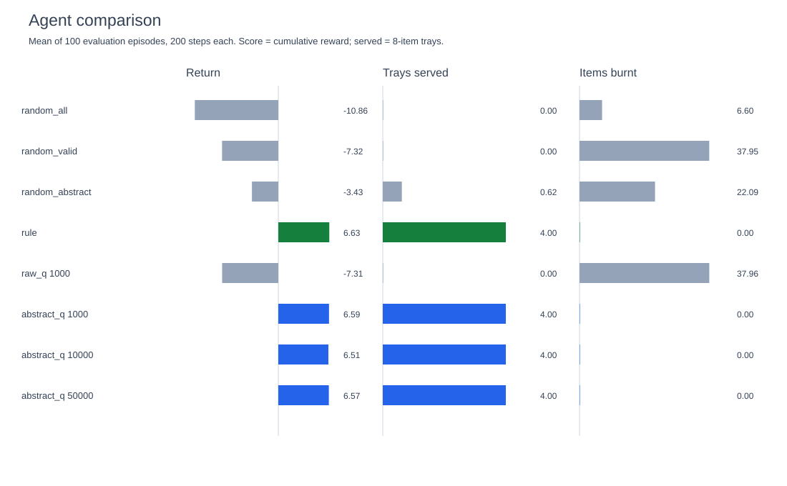
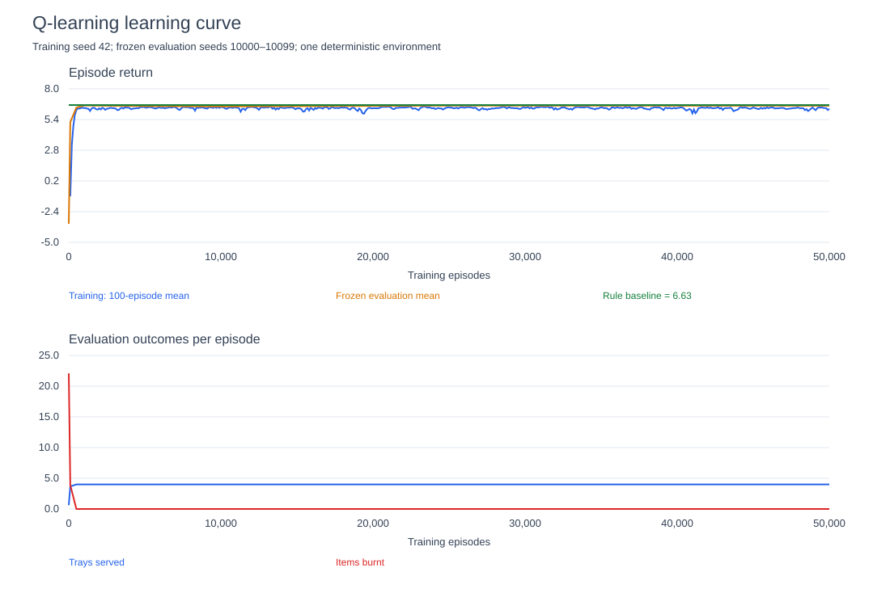

# Takoyaki Cooking RL — Final Technical Report

Project status: **Completed**. Closure date: October 22, 2026 (Asia/Seoul).

## 1. Project Overview

This is a small, deterministic cooking and scheduling experiment. An agent controls
16 independent takoyaki cells and one tray during a 200-second episode. The closure
work preserves the original environment, reproduces the rule baseline, evaluates the
existing tabular learner and a compact representation, and records measured results.
There is no graphics, business simulation, customer model or external dataset.

The project is located at `/home/darek123/python_projects/takoyaki_cooking_rl` on
`Darek987`. The existing Python 3.13.5 virtual environment was reused. No Git repository
was present, so no commit was created; no remote push or system configuration change
was performed. All original checkpoints and the legacy leaderboard are preserved.

## 2. Problem Definition

Each step consumes one second and selects one operation: wait, pour batter, add
octopus, flip, move to tray, sauce, serve or clear a burnt cell. The two flips share
an environment action type but apply to different cooking stages. The problem is to
schedule these operations across cells while avoiding burn deadlines and completing
8-item trays before the fixed horizon.

A tray requires at least 8 × 5 + 2 = 42 actions: five per item (batter, octopus,
first flip, second flip, move) plus sauce and serve. Thus five trays require at
least 210 actions, exceeding the 200-step horizon. **Four served trays is a hard
upper bound under this initial state and action model.** This bound concerns trays,
not shaped return, which also rewards partially completed food.

## 3. Environment Design

The unchanged `env.py` implements a 4×4 grid. Cells move through EMPTY → BATTER →
OCTOPUS → SHAPED → COOKED → FINISHED, or BURNT. SHAPED automatically becomes COOKED
after six timer increments. COOKED and FINISHED burn at timer ≥ 5. An action is
applied before time advances; the first flip leaves SHAPED at timer 1 on that same
step, and the second flip leaves FINISHED at timer 1. The automatic SHAPED→COOKED
transition resets the timer to zero. These boundary semantics were tested.

Moving a finished item empties its cell. A tray holds eight items; only a full
tray can be sauced and then served. Serving empties the tray. BATTER and OCTOPUS
do not burn. Reset is always identical. Termination is `t >= 200`; there is no
additional terminal reward or unfinished-food penalty. The caller must stop on
`done`; the legacy API does not block extra steps after termination.

## 4. State Space / Action Space

The original observation is `(time, tuple(cell_states), tuple(timers), tray_count,
tray_sauced)`. Time and exact per-cell timers distinguish many trajectories. Even
ignoring timers and tray information, seven states across sixteen cells admit
7^16 combinations (not all reachable). The raw learner stored 197,164 observations
in only 1,000 episodes, demonstrating poor reuse.

The original action space contains 83 integers: one wait, four cell-targeted
operations ×16, two tray operations and sixteen clears. `valid_actions()` masks
operations inconsistent with the current state. The environment remains unchanged.

The compact learner uses `(time//40 capped at 4, tray_count//2, tray_sauced,
cell-state presence bitmask, any cooked timer>=3, any finished timer>=3)`.
The final run visited 3,986 compact keys after 50,000 episodes.
Its Cartesian upper bound is 5×5×2×128×2×2 = 25,600 keys. Counts, cell identities,
exact timers and shaped-food readiness are lost, so this abstraction is not Markov.

Nine abstract actions distinguish wait, batter, octopus, first flip, second flip,
move, sauce, serve and clear. For cell actions, the oldest eligible cell is selected,
with the lowest index breaking ties. This is an explicit hand-coded scheduling
heuristic. Q-learning learns the operation category, not arbitrary cell allocation.
`abstract_agent.py` contains the complete adapter.

## 5. Reward Function

Every step receives −0.01. Invalid actions incur an additional −0.05; every newly
burnt item incurs −0.20. Valid shaping rewards are +0.01 batter, +0.01 octopus,
+0.02 first flip, +0.03 second flip, +0.05 moving an item, +0.02 sauce, and +1.00
serving a tray. Wait and clear give no additional reward. Reward shaping can favor
unfinished work near the end; return is not identical to delivered food.

**Terminology:** this report's “Average Score” is cumulative episode reward, matching
the handoff's historical 6.63. “Average Served” is completed eight-item trays,
matching historical 4.0. The environment's `info['score']` instead counts trays;
the original trainer calls that quantity Score and cumulative reward Reward.
The original leaderboard remains unchanged with its original terminology.

## 6. Baseline Agents

- **Random-all:** uniform over all 83 actions, matching the original script's policy.
- **Random-valid:** uniform over valid original actions, controlling for validity masking.
- **Random-abstract:** uniform over available abstract categories, with the same oldest-cell
  selection as abstract Q-learning; this exposes gains from the representation itself.
- **Rule:** the original priority policy: sauce/serve, clear burnt cells, move finished,
  flip cooked, flip octopus, add octopus, pour batter, otherwise wait.

The original Rule script was run before modifications for 100 episodes: return
6.63, four trays, zero invalid actions, zero burns. The common evaluator reproduces
these values. The Random script previously read the last step's `served` Boolean
as the episode count; it now reads the cumulative tray count. Baseline scripts have
main guards so importing the rule policy does not silently run 100 episodes.

## 7. RL Algorithm and Training Setup

Both variants reuse `QLearningAgent` and the original Q-learning update:
`Q(s,a) += alpha * (r + gamma * max_valid Q(s_next,.) - Q(s,a))`, with bootstrap zero
on terminal transitions. Unseen values are zero. Tied greedy actions are random.
Alpha=0.15, gamma=0.95, initial epsilon=1.0, minimum epsilon=0.05, multiplicative
episode decay=0.995. Epsilon reaches its floor around episode 598.

Raw Q-learning was trained fresh for 1,000 episodes. It was deliberately not extended
to 10,000/50,000: observed near-linear state growth offers poor memory efficiency,
and the compact variant provides the requested longer learning-budget comparison.
The raw 1,000-episode checkpoint is saved separately from legacy snapshots.

Abstract Q-learning was trained continuously for 50,000 episodes, with checkpoints
at 1,000, 10,000 and 50,000. Intermediate evaluations were also taken at 0, 100,
500, 5,000 and 25,000. All training used seed 42. There was no search or reward tuning.
Raw training took 7.69 seconds; abstract training took
447.94 seconds, including in-loop checkpoint evaluation
and I/O. These are observed wall times on this machine, not portable benchmarks.

Evaluation consists of 100 complete episodes at each snapshot, with agent RNG seeds
10000 through 10099. Exploration is disabled and no updates occur. RNG state is
restored after evaluation; Q lookups do not insert unseen states. The original
trainer's evaluation now seeds the actual agent RNG and restores it. The environment
itself has no stochasticity. Results are stored per episode, not just rounded means.

No external packages were installed. All execution, tests and SVG generation use
Python's standard library. `config.json` records Python/platform, parameters, seeds,
UTC timestamps and SHA-256 hashes of Python sources present when the run began.
Subsequently added plotting/reproduction helpers are included in the closure manifest.

## 8. Experimental Results

All values below are obtained from actual runs, with 100 evaluation episodes per row.

| Agent | Training episodes | Avg score (return) | Avg served (trays) | Avg burnt (items) | Avg invalid | Avg waste proxy |
|---|---:|---:|---:|---:|---:|---:|
| random_all | 0 | -10.8560 | 0.0000 | 6.6000 | 159.2900 | 161.8100 |
| random_valid | 0 | -7.3154 | 0.0000 | 37.9500 | 0.0000 | 12.6200 |
| random_abstract | 0 | -3.4308 | 0.6200 | 22.0900 | 0.0000 | 43.4800 |
| rule | 0 | 6.6300 | 4.0000 | 0.0000 | 0.0000 | 0.0000 |
| raw_q | 1000 | -7.3064 | 0.0000 | 37.9600 | 0.0000 | 12.3700 |
| abstract_q | 1000 | 6.5900 | 4.0000 | 0.0000 | 0.0000 | 1.0000 |
| abstract_q | 10000 | 6.5100 | 4.0000 | 0.0000 | 0.0000 | 3.0000 |
| abstract_q | 50000 | 6.5700 | 4.0000 | 0.0000 | 0.0000 | 3.0000 |

“Waste proxy” is invalid actions plus WAIT actions when at least one non-WAIT action
is valid. This is operationally measurable but **not a proof that waiting was useless**;
waiting may be strategically useful. Raw wait counts and this proxy are both saved.

At 50,000 episodes, the compact learner served 4.00 trays
with return 6.5700, 0.00 burns and
0.00 invalid actions. Compare the results against both
Rule and Random-abstract: masking and the oldest-cell heuristic are substantial
prior knowledge, and zero invalid actions is guaranteed by masking.



## 9. Learning Curve Analysis



The plot shows training return in nonoverlapping 100-episode means alongside frozen
checkpoint evaluation. Exploratory training return and greedy evaluation return are
different quantities. The raw learner stays close to Random-valid at 1,000 episodes.
The compact learner improves rapidly from its untrained policy and reaches four trays
by 500 episodes. Its evaluation return is 6.59 at 1,000 and 6.51 at 10,000; more training
does not guarantee monotonically better return. Constant learning rate, continuing
exploration, state aliasing and shaping provide plausible explanations; they were not
isolated experimentally. The CSV includes every training episode and every evaluation.

Zero evaluation spread in a deterministic greedy policy does not establish confidence
across training seeds or environment variations. `sd_score` in comparison.csv measures
only across the 100 evaluation episodes for that one trained snapshot.

## 10. Failure Analysis

The original full observation is too specific for useful tabular generalization at
the tested budget: most encountered states are new, so greedy choice often falls back
to tied zero values. Its 1,000-episode score is −7.3064 and no tray is served, with
37.96 burnt items on average. This is an empirical failure at that budget, not proof
that tabular learning could never succeed with more resources.

Random-all wastes most actions on invalid operations. Random-valid removes that cost
but advances many cells without respecting burn deadlines, producing more burns.
Random-abstract benefits from prioritizing the oldest cell within each operation but
still chooses poor operation sequences. The learned category policy improves on it.

The compact learner cannot observe multiplicity or exact cooking readiness. Different
physical situations map to one key and can need different actions. Its performance
therefore depends on both learning and the manually chosen cell resolver.

## 11. Limitations

- One training seed and one deterministic environment configuration; no distributional
  generalization or multi-seed confidence claim is made.
- The compact state is partially observable, and its action resolver contains domain knowledge.
- Four trays is throughput-optimal by the action-count bound; return optimality is unproven.
- Reward includes unfinished food; partial trays and food remaining at t=200 have no explicit cost.
- Wasted actions is a proxy, not a counterfactual efficiency measure.
- Raw Q-learning was capped at 1,000 episodes for practicality; legacy snapshots were preserved,
  but historical runs lack sufficient metadata to claim bitwise reproduction of their training.
- The minimal environment expects in-range action IDs and callers to stop on done. Out-of-range
  IDs can fail while formatting info; this legacy behavior was not changed for the experiments.
- Pickle checkpoints are for trusted local files. They omit RNG continuation state, so exact
  interrupted-training resumption is not supported; fresh seeded runs and frozen evaluation are.
- No lint/type/coverage toolchain existed. Nine targeted unittest checks and empirical evaluation
  were used; no unrun lint, type check or coverage percentage is claimed.

## 12. Conclusion

The requested closure is complete. The historical Rule baseline is reproduced, the
existing raw-state learner is evaluated honestly, and compact Q-learning demonstrates
learning relative to an untrained policy with the same abstraction. It reaches the
four-tray throughput limit in the tested setting. All required learning budgets were
executed for the compact learner and their actual outcomes saved. This is a completed
small personal experiment, not a broad RL benchmark or evidence of general scheduling
intelligence. No additional development is required for this closure scope.

## 13. Reproduction Instructions

From the existing project root:

```bash
cd /home/darek123/python_projects/takoyaki_cooking_rl
.venv/bin/python -m unittest -v
.venv/bin/python rule_agent.py
.venv/bin/python random_agent.py
.venv/bin/python verify_results.py experiments/final_seed42
```

To train from scratch without overwriting delivered results:

```bash
.venv/bin/python final_experiment.py --output experiments/reproduction_seed42 --seed 42 --episodes 50000 --raw-episodes 1000 --eval-episodes 100
.venv/bin/python plot_results.py experiments/reproduction_seed42
.venv/bin/python verify_results.py experiments/reproduction_seed42
```

The standalone Random script uses one continuous RNG seeded at 10000; the common
evaluator reseeds per episode, so its sample mean can differ from the standalone script.

The output directory must not already exist. On another machine, Python 3.13.5 is the
recorded version; no pip dependencies are required. Matching random algorithms and
Python version avoids version-related reproducibility uncertainty. The raw legacy
training entry point remains usable with distinct output paths:

```bash
.venv/bin/python train.py --episodes 1000 --seed 42 --checkpoint-dir experiments/legacy_reproduction_checkpoints --leaderboard experiments/legacy_reproduction.csv
```

`play_snapshot.py` accepts raw-state snapshots only; compact snapshots must be evaluated
through the abstraction-aware `verify_results.py`. Checkpoint evaluation was rerun and
matched the saved episode-level metrics for all four saved trained snapshots and four
baselines (800 episodes total). Full training was run once, not independently duplicated.

Files: `comparison.csv`, `evaluation_episodes.csv`, `learning_curve.csv`, `config.json`,
four `.pkl` snapshots and two SVG plots are in `experiments/final_seed42/`.
`experiments/tests.txt`, `reproduction.txt`, `legacy_sha256.txt`, `closure_manifest.json`
and `FINAL_REVIEW.md` record checks, provenance and scope. The original source backup is
`experiments/pre_closure_source.tar`; original `checkpoints/` and `leaderboard.csv` remain.
